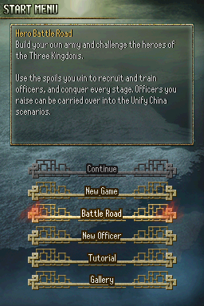
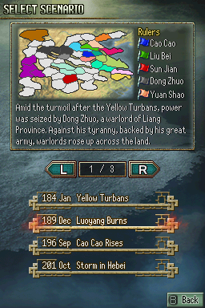
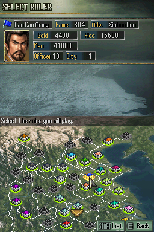
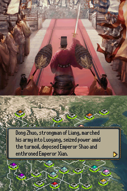
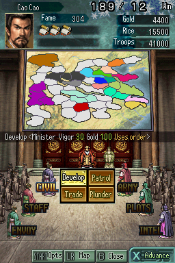
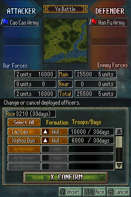
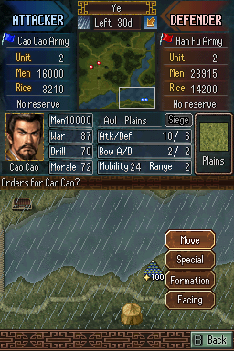
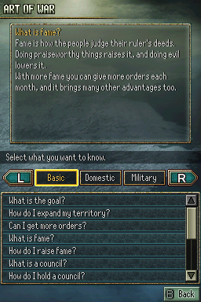
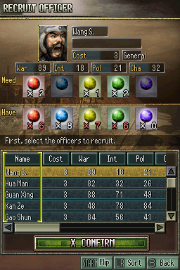

# Romance of the Three Kingdoms DS 3 (Sangokushi DS 3) — English Translation

A fan translation of **Sangokushi DS 3** (三國志DS3, Koei, 2010), the Nintendo DS
entry in the *Romance of the Three Kingdoms* series, into English. The game was only
released in Japan.

> **This is a full machine translation.** All of the game's text was translated from
> Japanese by an AI model, not by a human translator, and it has not been
> proofread by a fluent Japanese speaker. Expect occasional mistranslations, awkward
> phrasing and inconsistent terms. Corrections are welcome.

This repository contains the English text and the tools that build the patch.
It does **not** contain the game, any of its data, or the Japanese script — you need
your own copy of the game.

## Screenshots

| | | |
|:-:|:-:|:-:|
|  |  |  |
| Start menu | Scenario select | Ruler select |
|  |  |  |
| Story event | Strategy screen | Deploying units |
|  |  |  |
| Battle | Art of War (help) | Hero Battle Road |

## What's translated

- All story events, dialogue, advisor and council text, battle messages
- Menus, commands, help (Art of War) and tutorial text
- Officer, city, item and Hero Battle Road stage names
- Menu and battle graphics: buttons, titles, column headers, labels and banners,
  redrawn with an original English font
- A variable-width font, so English text is proportional and readable

Long names are shortened where the game's boxes are too small (e.g. a few city and
skill names); full names are kept in `tl/names_*.json` (`full` field).

**Intentionally not translated:** the ending staff roll, which is left as in the
original Japanese release.

## Applying the patch (players)

1. Download the release zip (`Sangokushi_DS_3_English_v<version>.zip`) from the
   Releases page. It contains the patch, `sangokushi_ds_3_en_v<version>.xdelta`.
2. You need an unmodified dump of the Japanese game (game code `B35J`):

   | | |
   |---|---|
   | Size  | 67,108,864 bytes |
   | CRC32 | `58E981CD` |
   | MD5   | `ba072b5743814a8a41c58c1f4f707735` |
   | SHA-1 | `b2e33ee0826db5862ed096ae93086c93d51713da` |

3. Apply it with an xdelta tool, e.g. [Delta Patcher](https://github.com/marco-calautti/DeltaPatcher)
   or the command line:

   ```
   xdelta3 -d -s sangokushi_ds_3.nds sangokushi_ds_3_en_v<version>.xdelta sangokushi_ds_3_en.nds
   ```

## Building from source

Requirements: Python 3.10+, `xdelta3` (optional, for the patch file).

```
python -m venv .venv
.venv/bin/pip install -r requirements.txt
cp /path/to/your/dump.nds sangokushi_ds_3.nds     # must match the checksums above
.venv/bin/python tools/setup.py                    # extracts script/ from your ROM, applies tl/
.venv/bin/python tools/build.py                    # writes build/sangokushi_ds_3_en.nds + .xdelta
```

`tools/setup.py` checks the ROM's SHA-1 and generates `script/`, which pairs the
Japanese text from your ROM with the English from `tl/`. `script/` and `build/`
are never committed. Re-run `setup.py` after editing anything in `tl/`.

To make a release package, run `.venv/bin/python tools/package.py 0.9` after building:
it writes `release/<name>_v0.9.zip` with the versioned xdelta patch and a plain-text
README.txt (notice, patching instructions, clean and patched ROM checksums, known
issues, credits). The ROM itself is never packaged.

## Repository layout

| Path | Contents |
|---|---|
| `tl/msgsecNN.txt` | English for each message file, by entry number (`@N`) |
| `tl/arm9.txt` | English for UI strings in the game code, by address |
| `tl/names_*.json` | English officer, city, item and stage names |
| `tools/build.py` | Builds the patched ROM and the patch |
| `tools/setup.py` | Creates `script/` from your ROM and `tl/` |
| `tools/tl.py` | Validates and word-wraps translations (`apply`, `show`, `stats`) |
| `tools/patch_arm9.py` | Code patches: ASCII font, variable-width text, layout fixes |
| `tools/gfx.py`, `bgtext.py`, `gfxtext.py` | Redraw English labels into the game's graphics at build time |
| `tools/font6x12.py`, `boldfont.py` | Original fonts drawn for this project |
| `tools/package.py` | Makes the release zip (patch + README.txt with checksums) |
| `tools/dev/` | Development helpers (previews, measurements) |

## Known issues

- In typhoon/harvest event messages, the list of affected cities can run together
  (e.g. `NanpiPingyChenl`): the game copies each city name into a fixed 5-byte slot.
- On the officer info screen, a city name of 27px or more runs into the faction
  name next to it (e.g. `ChenliuCao Cao Army`); the faction is drawn at a fixed column.
- On the battle screen, 5-digit troop counts touch the "Men" label (`Men10000`).
- The title screen's "Press a button / touch the lower screen" glow still shows faint
  traces of the original Japanese text behind it.
- A few screens have not been seen in an emulator yet (victory/defeat banners, gallery
  card and event screens, the ending); they were checked in previews only.
- On the tutorial's chapter buttons, the completion checkmark overlaps the "Chapter N"
  label.
- If battles stop asking for your orders after the first turn on a 3DS, DSi or
  flashcart, update your loader or flashcart firmware. The unpatched Japanese game
  behaves the same way.
- Some crashes have been observed that appear to be triggered by certain
  translated text in the game. If the game freezes or crashes, please report it
  (see below) with where it happened and, if possible, a save state from just before.

Tested in melonDS and on a 3DS.

Please report bugs, including crashes and mistranslations, as
[GitHub issues](https://github.com/damon-daemon/sangokushi-ds-3-english/issues), with a screenshot
and where it happened.

## Credits

- Translation and hacking: [damon-daemon](https://github.com/damon-daemon)
- Sangokushi DS 3 © 2010 Koei Tecmo. This is an unofficial fan project, not
  affiliated with or endorsed by Koei Tecmo. Please support the official releases.

## License

The tools, fonts, documentation and English translation text in this repository
are released under the [MIT License](LICENSE). This covers only original work in
this repository: the game itself and all of its content (code, Japanese text,
graphics, audio) are copyright Koei Tecmo and are not included or licensed here.
